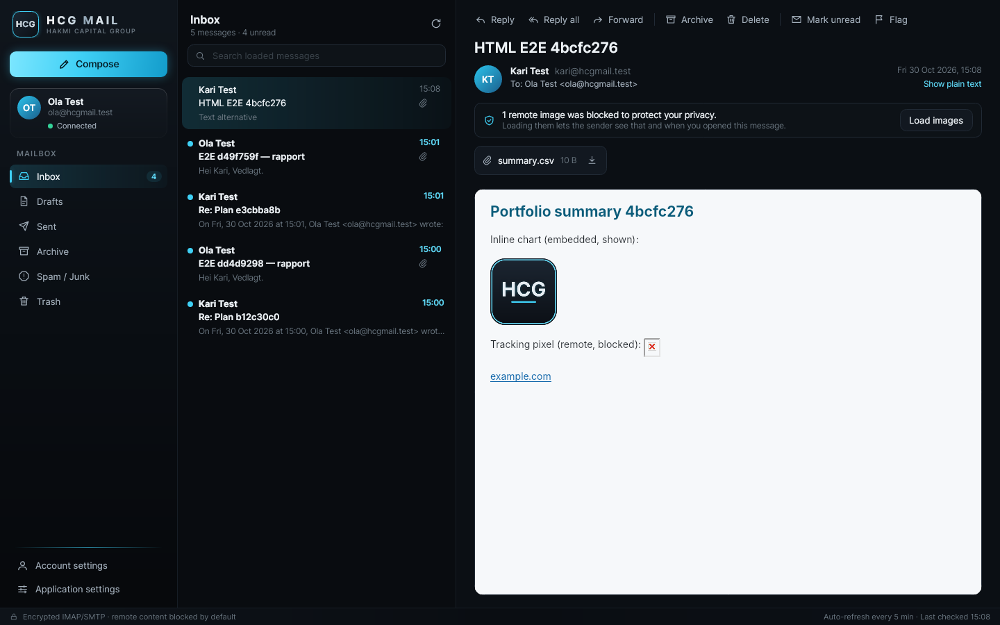
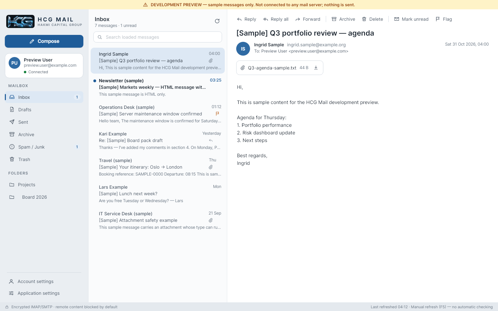
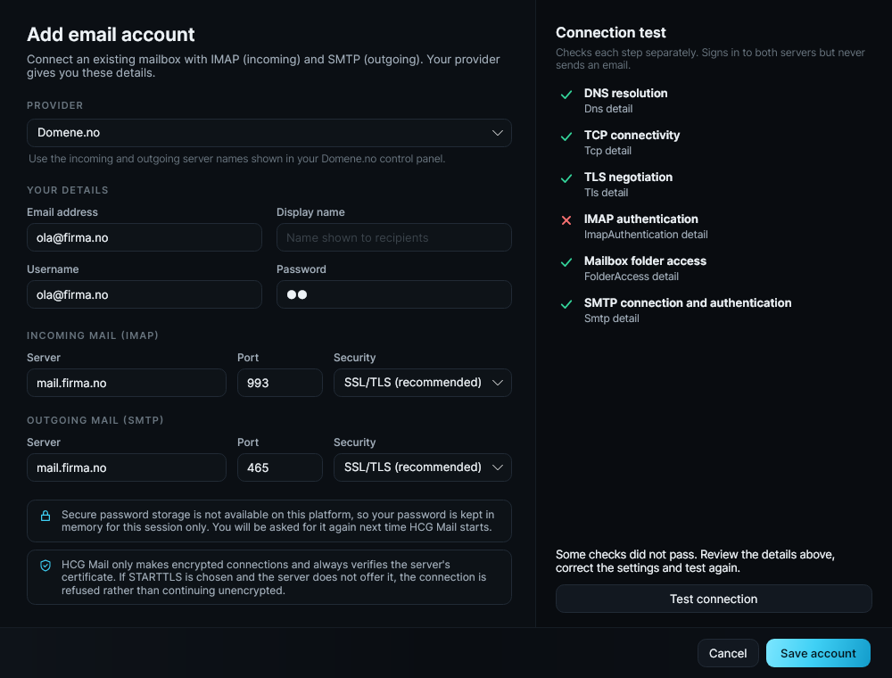

# HCG Mail — Windows executable Application

**Native email client for Windows 10/11 · Hakmi Capital Group**

> This folder (`Windows executable Application/` in the
> [HCG Mail repository](../README.md)) contains the HCG Mail application: one .NET 10 / Avalonia
> codebase that is published as the Windows executable and also builds and runs on macOS for
> development. All commands below are run **from this folder**; all paths in this folder's
> documentation are relative to it.

HCG Mail connects to any existing mailbox over standard **IMAP and SMTP** — for example a privately
hosted Domene.no domain mailbox. It does not need Outlook, Microsoft 365, Exchange, or an HCG account,
and it never contacts HCG infrastructure.



| HCG Classic | Account setup with step-by-step connection test |
|---|---|
|  |  |

## Status — MVP 0.1.0

| Area | State |
|---|---|
| Receive: folders (special-use aware), message list, read, refresh, search loaded messages, load older | ✅ implemented, tested against a real Dovecot server |
| Mark read/unread, flag, delete → Trash, permanent delete in Trash, Archive, unread counts | ✅ implemented, tested against a real server |
| Attachments: list, save (sanitized file names, never opened), dangerous-type warning | ✅ |
| Send: To/Cc/Bcc, attachments, reply, reply all, forward (with attachments), threading headers | ✅ tested via real Postfix SMTP |
| Sent folder copy without duplicates (Gmail detection + Message-ID check) | ✅ |
| Server-side drafts (save, re-save replaces, edit, send removes draft) | ✅ |
| Six-step connection test (DNS, TCP, TLS, IMAP login, folders, SMTP login — no mail sent) | ✅ |
| Safe HTML: sanitizer + script-less renderer, remote images blocked by default, link confirmation | ✅ |
| Password storage: Windows Credential Manager / macOS Keychain | ✅ Windows code verified under Wine; ⚠️ macOS Keychain not yet run on a Mac |
| HCG Future / HCG Classic skins, live switching, persisted | ✅ |
| Windows x64 self-contained single-file build | ✅ builds; ⚠️ not yet run on real Windows hardware |
| Composer | Plain text only (HTML composing is on the roadmap) |
| System (OS) notifications | Not yet — notifications appear inside the HCG Mail window |
| Local message cache | Deliberately none: message bodies are never stored on disk |

Honest test record: see [docs/TESTING.md](docs/TESTING.md). Manual Domene.no checklist:
[docs/MANUAL_TEST_CHECKLIST.md](docs/MANUAL_TEST_CHECKLIST.md).

## Quick start (macOS)

```bash
# once: install the .NET 10 SDK (https://dotnet.microsoft.com/download) — e.g. brew install --cask dotnet-sdk
dotnet --version          # 10.0.x

cd "HCG-Mail/Windows executable Application"     # quotes needed: the folder name has spaces
dotnet restore
dotnet build
dotnet test
dotnet run --project src/HCG.Mail.App                 # real mode
dotnet run --project src/HCG.Mail.App -- --developer-preview   # Debug builds only: labelled sample data, no network
```

Windows test build (from the Mac): `scripts/publish-windows.sh` → `artifacts/HCGMail-0.1.0-mvp-win-x64.zip`.
Details in [docs/WINDOWS_BUILD.md](docs/WINDOWS_BUILD.md).

## Repository layout

```
HCG.Mail.sln
src/
  HCG.Mail.Core/            domain model, validation, folder-role mapping, reply logic, contracts (no dependencies)
  HCG.Mail.Email/           MailKit/MimeKit IMAP+SMTP session, connection tester, MIME conversion, HTML sanitizer
  HCG.Mail.Infrastructure/  OS credential vaults, JSON settings/account stores, file logging, app paths
  HCG.Mail.App/             Avalonia UI (MVVM), skins, views, view models, development preview
tests/
  HCG.Mail.Tests/           unit tests + opt-in end-to-end tests against a local test server
  HCG.Mail.App.Tests/       headless UI tests (real views rendered with Skia)
  integration-server/       script that creates a disposable Dovecot/Postfix server for end-to-end tests
assets/branding, assets/icons   official HCG logo and application icon (supplied)
docs/                       ARCHITECTURE, SETUP, SECURITY, WINDOWS_BUILD, ROADMAP, TESTING, MANUAL_TEST_CHECKLIST
scripts/                    publish-windows.sh / publish-windows.ps1
```

`tests/HCG.Mail.App.Tests` was added next to the requested `tests/HCG.Mail.Tests` because UI tests need
the Avalonia headless platform and a dedicated UI thread; keeping them separate keeps the core test
suite fast and free of UI dependencies.

## Documentation

- [Architecture](docs/ARCHITECTURE.md) · [Setup](docs/SETUP.md) · [Security](docs/SECURITY.md)
- [Windows build](docs/WINDOWS_BUILD.md) · [Roadmap](docs/ROADMAP.md) · [Testing](docs/TESTING.md)
- [Manual Domene.no checklist](docs/MANUAL_TEST_CHECKLIST.md) · [Branding assets](assets/branding/README.md)

## Branding

Official Hakmi Capital Group artwork supplied by the founder: the **HCG logo** in the sidebar header,
welcome card and About page, and the **HCG Mail application icon** for the executable, taskbar and
window title bars — see [assets/branding/README.md](assets/branding/README.md).
